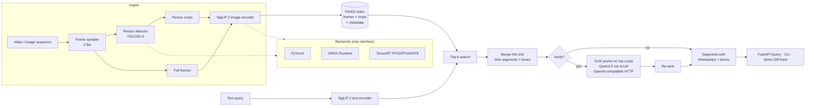

# vidquery

**Text-to-video person search with VLM verification.** Ask for *"man in a blue shirt walking
left"* and get back time segments with bounding boxes. vidquery samples frames, detects people
with YOLO, embeds full frames and person crops with SigLIP 2, and searches them with FAISS. Hits
are merged into time segments, and an optional small VLM served by vLLM re-checks the top
results with a yes/no question. It is built as a deployment exercise. The detector and image
encoder run interchangeably on PyTorch, ONNX Runtime and TensorRT (FP32/FP16/INT8), with export
scripts, a numerical parity checker, a benchmark harness and a retrieval evaluation. It ships as a
FastAPI service, a CLI, Docker images and Slurm/Apptainer jobs for an H100 cluster.

## Architecture



| Stage | Default | Notes |
|---|---|---|
| Detector | `yolo26s.pt` (Ultralytics YOLO26-S, NMS-free head) | dense-head models (YOLO11/v8) also supported |
| Image/text encoder | `google/siglip2-so400m-patch16-384` | FixRes SigLIP 2: static shapes, so it builds cleanly in TensorRT |
| Index | FAISS `IndexFlatIP` over L2-normalised vectors | frames and crops in two indexes sharing one id space |
| Verifier | `Qwen/Qwen3.5-4B` on vLLM ≥ 0.17 (`Qwen3.5-2B` for low memory) | p(yes) read from first-token logprobs, thinking disabled |

## Quickstart

### 1. Weight-free demo (CPU, about a minute)

Deterministic "colour" models stand in for the detector and encoder, so the whole pipeline runs
without downloading anything:

```bash
python -m venv .venv && source .venv/bin/activate
pip install torch --index-url https://download.pytorch.org/whl/cpu
pip install -e ".[cpu,dev]"

python scripts/make_synthetic_data.py --out data/synthetic
vidquery ingest data/synthetic/synthetic.mp4 -c configs/mock.yaml
vidquery query "a person in blue walking left" -c configs/mock.yaml
vidquery demo "a person in red" -c configs/mock.yaml --out results/demo.gif
python scripts/eval_retrieval.py -c configs/mock.yaml --queries data/synthetic/queries.jsonl
```

### 2. Real models

```bash
pip install -e ".[cpu,yolo]"        # or ".[gpu,yolo]" inside the TensorRT container
vidquery ingest path/to/video.mp4    # configs/default.yaml values; weights download on first use
vidquery query "man in a blue shirt walking left" -k 5
vidquery demo "woman with a stroller" --out results/stroller.mp4
```

Switch backends from the config or the command line:

```bash
vidquery export onnx                                   # detector, image + text encoders
vidquery export trt --precisions fp32 fp16             # needs TensorRT + a GPU
vidquery parity --backends onnxruntime tensorrt:fp32 tensorrt:fp16
vidquery ingest video.mp4 --set detector.backend=tensorrt --set encoder.backend=tensorrt \
    --set detector.precision=fp16 --set encoder.precision=fp16
```

### 3. API

```bash
vidquery serve                     # http://localhost:8080/docs
curl -X POST localhost:8080/ingest -H 'content-type: application/json' \
     -d '{"video_path": "/data/videos/cam1.mp4", "background": true}'
curl -X POST localhost:8080/query -H 'content-type: application/json' \
     -d '{"text": "man in a blue shirt walking left", "max_segments": 5, "verify": true}'
curl localhost:8080/health
```

`/query` returns segments (`video_id`, `start`, `end`, `score`, `retrieval_score`,
`verifier_score`) with their hits (`timestamp`, `frame_idx`, `box` as `[x1, y1, x2, y2]` in
source pixels).

### 4. Docker

```bash
docker build -f docker/Dockerfile.cpu -t vidquery:cpu .                 # slim CPU image (CI builds it)
docker build -f docker/Dockerfile.gpu -t vidquery:gpu .                 # FROM nvcr.io/nvidia/tensorrt
docker run --rm --gpus all -p 8080:8080 -v $PWD/data:/data vidquery:gpu serve
```

## Backends, export and parity

| Path | Command | Details |
|---|---|---|
| torch → ONNX | `scripts/export_onnx.py` | dynamic batch; dynamo exporter (opset 18) or TorchScript (opset 17); Ultralytics' exporter for YOLO |
| ONNX → TensorRT | `scripts/build_trt.py --precisions fp32 fp16` | optimisation profile 1/8/32; FP32 builds disable TF32 |
| INT8 | `scripts/build_trt.py --precisions int8 --calib <videos>` | entropy calibration on real frames + person-shaped crops, or `--int8-method modelopt` (Q/DQ) |
| Parity | `scripts/parity_check.py` | vs PyTorch FP32: max/mean abs, `allclose`, min cosine, and detection F1 on decoded boxes; per-precision tolerances, override with `--tolerances` |

## Benchmarks

`scripts/benchmark.py` measures p50/p95 latency, throughput and peak GPU memory per backend and
batch size (1, 4, 8, 16), plus end-to-end ingest FPS on a MOT17 sequence. Each backend runs in its
own process. Results go to `results/benchmark.json` and `results/benchmark.md`.

*Placeholder: fill in from `results/benchmark.md` after `sbatch slurm/benchmark.sbatch` on an H100.*

| component | backend | batch | p50 ms | p95 ms | items/s | peak GPU MB |
|---|---|---|---|---|---|---|
| detector (YOLO26-S, 640) | pytorch:fp32 | 8 | – | – | – | – |
| detector | pytorch:fp16 | 8 | – | – | – | – |
| detector | onnxruntime:fp32 | 8 | – | – | – | – |
| detector | tensorrt:fp32 | 8 | – | – | – | – |
| detector | tensorrt:fp16 | 8 | – | – | – | – |
| detector | tensorrt:int8 | 8 | – | – | – | – |
| image encoder (SigLIP 2 So400m/16, 384) | pytorch:fp32 | 16 | – | – | – | – |
| image encoder | tensorrt:fp16 | 16 | – | – | – | – |
| image encoder | tensorrt:int8 | 16 | – | – | – | – |

| backend | ingest FPS (sampled frames/s) | × realtime | detect s | embed s |
|---|---|---|---|---|
| pytorch:fp32 | – | – | – | – |
| tensorrt:fp16 | – | – | – | – |

## Retrieval evaluation

`scripts/eval_retrieval.py` reads `queries.jsonl` lines like
`{"query": "...", "video_id": "MOT17-04", "gt": [[12.0, 18.5]]}` and reports, with and without the
VLM verifier:

* **R@k**: fraction of queries with a correct segment (same video, temporal overlap) in the top k
* **SegHit@10**: fraction of all ground-truth ranges covered by a top-10 segment
* **P@10**, **MRR**, and query latency

MOT17 has no text annotations, so the queries have to be written by hand (see
`data/queries.example.jsonl` for the format).

*Placeholder: fill in from `results/eval.md`.*

| setting | R@1 | R@5 | R@10 | SegHit@10 | P@10 | MRR | p50 ms |
|---|---|---|---|---|---|---|---|
| embedding only | – | – | – | – | – | – | – |
| with VLM verifier | – | – | – | – | – | – | – |

## Deploying on an HPC cluster with Apptainer

The `slurm/` folder targets the Digital Research Alliance of Canada **Fir** cluster (H100), but any
Slurm + Apptainer cluster works with small edits to `slurm/env.sh`. Docker isn't available there,
so the NGC TensorRT and vLLM images are pulled as Apptainer SIFs. A Python venv is created
*inside* the TensorRT container (`--system-site-packages`, so it sees the container's TensorRT),
pinned by a lock file and packed into one SquashFS image to stay within the file quota.
Containers, venv, weights, caches, data and results all live on `$SCRATCH`. Jobs use cached files
only by default (`VQ_ONLINE=1` lifts this).

```bash
git clone <this repo> ~/vidquery && cd ~/vidquery
mkdir -p $SCRATCH/vidquery/logs

# One-time CPU job: pull TensorRT + vLLM, venv, weights, MOT17 (+ mp4s), CPU tests
sbatch slurm/setup.sbatch

# GPU jobs (submit from the repo root)
sbatch slurm/export.sbatch              # ONNX + TensorRT FP32/FP16 (+ INT8=1), parity, GPU tests
sbatch slurm/benchmark.sbatch           # latency/throughput/memory + ingest FPS
sbatch slurm/ingest.sbatch              # index all MOT17 sequences
sbatch slurm/eval.sbatch                # eval with/without verifier (starts vLLM in-job)
sbatch slurm/vllm.sbatch                # or: standalone vLLM server for other jobs
```

The pulls are equivalent to:

```bash
apptainer pull $SCRATCH/vidquery/containers/tensorrt_26.03-py3.sif docker://nvcr.io/nvidia/tensorrt:26.03-py3
apptainer pull $SCRATCH/vidquery/containers/vllm-openai_v0.17.1.sif docker://vllm/vllm-openai:v0.17.1
apptainer exec --nv --bind $SCRATCH $SCRATCH/vidquery/containers/tensorrt_26.03-py3.sif nvidia-smi
```

See [`slurm/README.md`](slurm/README.md) for the knobs (`VQ_*` variables, INT8, using a running vLLM).

## Configuration

Settings are typed (pydantic) and loaded from YAML (`configs/*.yaml`, or `$VIDQUERY_CONFIG`).
`${ENV}` references are expanded, and any value can be overridden with
`--set section.key=value`. Shipped configs:

* `default.yaml`: real models, single GPU or CPU
* `fir.yaml`: cluster paths on `$SCRATCH`, TensorRT FP16 by default
* `tiny.yaml`: tiny randomly initialised models for export/parity/benchmark smoke tests
* `mock.yaml`: deterministic colour models for the weight-free demo

## Development

```bash
pip install -e ".[cpu,dev]"
ruff check src tests scripts && ruff format --check src tests scripts
mypy
pytest                       # CPU only; GPU tests are marked @pytest.mark.gpu and skipped
pytest -m gpu                # on a CUDA machine with TensorRT
```

The CPU suite needs no internet and no weights. It uses tiny random SigLIP/YOLO-style models, a
deterministic colour detector/encoder and a synthetic video generated in the test. It covers
ONNX export with onnxruntime parity, FAISS, segment merging, the end-to-end pipeline, the verifier
against a mocked OpenAI-compatible server, the API, CLI, eval, benchmark and demo. GitHub Actions
runs lint, mypy, the tests and a CPU Docker build on every push.

## Limitations

* **Retrieval is per frame.** SigLIP sees single frames or crops, so motion phrases like
  *"walking left"* are only weakly grounded. Direction and actions would need tracking (e.g.
  ByteTrack over the detections) plus motion features or a video encoder.
* **No tracking yet.** Boxes are per sampled frame. Segments are merged by time, not by identity,
  so two different people matching the query close together become one segment.
* **Score calibration.** Frame and crop cosines are merged on one scale with a fixed margin
  (`query.score_margin`). Tune it per dataset with the eval script.
* **Sampling rate bounds recall.** At 2 fps, events shorter than ~0.5 s can be missed, and segment
  boundaries are only accurate to one sampling period.
* **The verifier is slow and expensive.** One VLM call per verified segment; its benefit has to be
  shown by the eval, which needs hand-written queries for MOT17.
* **TensorRT engines are not portable.** They are tied to the GPU model and TensorRT version that
  built them, so rebuild per cluster/container. INT8 accuracy depends on calibration data.
* **Single-process service.** The FAISS index lives in memory (exact search), and ingest jobs are
  tracked in memory. That's fine for thousands of videos, not for a multi-replica deployment.
* **Untested on GPU from this repo's CI.** GitHub Actions only runs CPU paths. TensorRT, CUDA EP
  and vLLM paths are exercised by the Slurm jobs.

## Project layout

```
src/vidquery/
  backends/        pytorch | onnxruntime | tensorrt behind InferenceBackend
  models/          detector, encoders, registry, tiny + mock models, SigLIP/YOLO wrappers
  export/          ONNX export, TensorRT builder, INT8 calibration
  pipeline.py      ingest + query engine        index.py     FAISS + metadata
  segments.py      hit merging                  verify.py    VLM verifier (HTTP)
  parity.py        cross-backend checks         bench.py     benchmark harness
  evaluation.py    retrieval metrics            api.py, cli.py, demo.py
scripts/           export, TensorRT, parity, benchmark, eval, MOT17 download/convert
slurm/             Apptainer + sbatch for the Fir cluster
configs/           default, fir, tiny, mock
tests/             CPU suite + GPU-marked tests
docker/            Dockerfile.cpu, Dockerfile.gpu (NGC TensorRT base)
```
