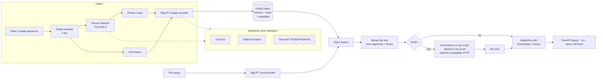

# vidquery

**Text-to-video person search with VLM verification.** Ask for *"man in a blue shirt walking
left"* and get back time segments with bounding boxes. vidquery samples frames, detects people
with YOLO, embeds full frames and person crops with SigLIP 2, and searches them with FAISS. Hits
are merged into time segments, and an optional small VLM served by vLLM re-checks the top
results with a yes/no question. It is built as a deployment exercise. The detector and image
encoder run interchangeably on PyTorch, ONNX Runtime and TensorRT (FP32/FP16/INT8), with export
scripts, a numerical parity checker, a benchmark harness and a retrieval evaluation. It ships as a
FastAPI service, a CLI, Docker images and Slurm/Apptainer jobs for an H100 cluster.

A second feature answers *"where was this filmed?"* with a deliberately coarse estimate: GeoCLIP
on sampled frames, aggregated into an area with a confidence radius and alternatives, plus an
optional VLM second opinion and a Leaflet map (see [Where was this filmed?](#where-was-this-filmed)).

## Architecture



| Stage | Default | Notes |
|---|---|---|
| Detector | `yolo26s.pt` (Ultralytics YOLO26-S, NMS-free head) | dense-head models (YOLO11/v8) also supported |
| Image/text encoder | `google/siglip2-so400m-patch16-384` | FixRes SigLIP 2: static shapes, so it builds cleanly in TensorRT |
| Index | FAISS `IndexFlatIP` over L2-normalised vectors | frames and crops in two indexes sharing one id space |
| Verifier | `Qwen/Qwen3.5-4B` on vLLM ≥ 0.17 (`Qwen3.5-2B` for low memory) | p(yes) read from first-token logprobs, thinking disabled |

## Quickstart

### 1. Weight-free demo (CPU, about a minute)

Deterministic "colour" models stand in for the detector and encoder, so the whole pipeline runs
without downloading anything:

```bash
python -m venv .venv && source .venv/bin/activate
pip install torch --index-url https://download.pytorch.org/whl/cpu
pip install -e ".[cpu,dev]"

python scripts/make_synthetic_data.py --out data/synthetic
vidquery ingest data/synthetic/synthetic.mp4 -c configs/mock.yaml
vidquery query "a person in blue walking left" -c configs/mock.yaml
vidquery demo "a person in red" -c configs/mock.yaml --out results/demo.gif
python scripts/eval_retrieval.py -c configs/mock.yaml --queries data/synthetic/queries.jsonl
```

### 2. Real models

```bash
pip install -e ".[cpu,yolo]"        # or ".[gpu,yolo]" inside the TensorRT container
vidquery ingest path/to/video.mp4    # configs/default.yaml values; weights download on first use
vidquery query "man in a blue shirt walking left" -k 5
vidquery demo "woman with a stroller" --out results/stroller.mp4
```

Switch backends from the config or the command line:

```bash
vidquery export onnx                                   # detector, image + text encoders
vidquery export trt --precisions fp32 fp16             # needs TensorRT + a GPU
vidquery parity --backends onnxruntime tensorrt:fp32 tensorrt:fp16
vidquery ingest video.mp4 --set detector.backend=tensorrt --set encoder.backend=tensorrt \
    --set detector.precision=fp16 --set encoder.precision=fp16
```

### 3. API

```bash
vidquery serve                     # http://localhost:8080/docs
curl -X POST localhost:8080/ingest -H 'content-type: application/json' \
     -d '{"video_path": "/data/videos/cam1.mp4", "background": true}'
curl -X POST localhost:8080/query -H 'content-type: application/json' \
     -d '{"text": "man in a blue shirt walking left", "max_segments": 5, "verify": true}'
curl localhost:8080/health
```

`/query` returns segments (`video_id`, `start`, `end`, `score`, `retrieval_score`,
`verifier_score`) with their hits (`timestamp`, `frame_idx`, `box` as `[x1, y1, x2, y2]` in
source pixels).

### 4. Docker

```bash
docker build -f docker/Dockerfile.cpu -t vidquery:cpu .                 # slim CPU image (CI builds it)
docker build -f docker/Dockerfile.gpu -t vidquery:gpu .                 # FROM nvcr.io/nvidia/tensorrt
docker run --rm --gpus all -p 8080:8080 -v $PWD/data:/data vidquery:gpu serve
```

## Backends, export and parity

| Path | Command | Details |
|---|---|---|
| torch → ONNX | `scripts/export_onnx.py` | dynamic batch; dynamo exporter (opset 18) or TorchScript (opset 17); Ultralytics' exporter for YOLO |
| ONNX → TensorRT | `scripts/build_trt.py --precisions fp32 fp16` | optimisation profile 1/8/32; FP32 builds disable TF32 |
| INT8 (experimental) | `scripts/build_trt.py --precisions int8 --calib <videos>` | entropy calibration on real frames + person-shaped crops; not in the deployed config (see below) |
| Parity | `scripts/parity_check.py` | vs PyTorch FP32. Encoders: max/mean abs, `allclose`, min cosine. Detector: detection F1 on decoded boxes (IoU 0.5, config score threshold) plus max box/score error on matched high-confidence detections. Per-precision tolerances, override with `--tolerances` |

**INT8 is not deployed.** On Fir (TensorRT 10.16) the entropy-calibrated YOLO26 detector agreed
with PyTorch FP32 on only 76% of detections (F1 0.76): calibration hurts the YOLO26 head. The
SigLIP 2 INT8 engine gave exactly the FP16 result, because TensorRT's implicit INT8 does not
quantize the transformer's matmuls. `configs/fir.yaml` therefore uses TensorRT FP16 for both
models; `INT8=1 sbatch slurm/export.sbatch` still builds and reports INT8 for comparison.

## Benchmarks

`scripts/benchmark.py` measures p50/p95 latency, throughput and peak GPU memory per backend and
batch size (1, 4, 8, 16), plus end-to-end ingest FPS on a MOT17 sequence. Each backend runs in its
own process. Results go to `results/benchmark.json` and `results/benchmark.md`.

*Placeholder: fill in from `results/benchmark.md` after `sbatch slurm/benchmark.sbatch` on an H100.*

| component | backend | batch | p50 ms | p95 ms | items/s | peak GPU MB |
|---|---|---|---|---|---|---|
| detector (YOLO26-S, 640) | pytorch:fp32 | 8 | – | – | – | – |
| detector | pytorch:fp16 | 8 | – | – | – | – |
| detector | onnxruntime:fp32 | 8 | – | – | – | – |
| detector | tensorrt:fp32 | 8 | – | – | – | – |
| detector | tensorrt:fp16 | 8 | – | – | – | – |
| detector | tensorrt:int8 | 8 | – | – | – | – |
| image encoder (SigLIP 2 So400m/16, 384) | pytorch:fp32 | 16 | – | – | – | – |
| image encoder | tensorrt:fp16 | 16 | – | – | – | – |
| image encoder | tensorrt:int8 | 16 | – | – | – | – |

| backend | ingest FPS (sampled frames/s) | × realtime | detect s | embed s |
|---|---|---|---|---|
| pytorch:fp32 | – | – | – | – |
| tensorrt:fp16 | – | – | – | – |

## Retrieval evaluation

`scripts/eval_retrieval.py` reads `queries.jsonl` lines like
`{"query": "...", "video_id": "MOT17-04", "gt": [[12.0, 18.5]]}` and reports, with and without the
VLM verifier:

* **R@k**: fraction of queries with a correct segment (same video, temporal overlap) in the top k
* **SegHit@10**: fraction of all ground-truth ranges covered by a top-10 segment
* **P@10**, **MRR**, and query latency

MOT17 has no text annotations, so the queries have to be written by hand (see
`data/queries.example.jsonl` for the format). When a description matches people in more than
one video, give `gt` as `{"MOT17-02": [[3.0, 8.5]], "MOT17-09": [[0.0, 4.0]]}` instead of
`video_id` + list. `"split": "val"` or `"test"` marks which queries may be used for tuning;
`--split test` evaluates only the held-out ones.

`vidquery browse "query" ... --timeline all` (or `slurm/browse.sbatch`) helps write them: it prints
the top segments per query, saves one contact sheet per query (best frame of each segment, boxes
drawn) and one sheet per video with a frame every second, captioned with timestamps. Take the
ground truth from the videos, not from the retrieved segments.

*Placeholder: fill in from `results/eval.md`.*

| setting | R@1 | R@5 | R@10 | SegHit@10 | P@10 | MRR | p50 ms |
|---|---|---|---|---|---|---|---|
| embedding only | – | – | – | – | – | – | – |
| with VLM verifier | – | – | – | – | – | – | – |

## Where was this filmed?

`vidquery locate` estimates where a video was recorded. The output is a coarse area, never a
point.

1. **Sample frames** at 1 fps (`geo.sample_fps`, capped at `geo.max_frames`).
2. **Skip person frames.** Frames whose person boxes cover more than half of the image
   (`geo.max_person_fraction`) are dropped. They say little about the place, and dropping them
   keeps the estimate about the scene, not the people in it.
3. **Predict per frame.** [GeoCLIP](https://github.com/VicenteVivan/geo-clip) (NeurIPS 2023) scores
   each remaining frame against a gallery of 100K GPS locations and keeps the top-k.
4. **Aggregate.** All frames' top-k points are pooled, weighted by a softmax over their logits,
   and clustered on the sphere.
   * The heaviest cluster is the estimate.
   * Its **confidence radius** is the distance that holds 68% of *all* the probability mass, so
     frames that disagree produce a large circle instead of a falsely precise point.
   * The next three clusters are the **alternatives**, each with its share of the mass.
5. **Round to the radius.** Coordinates get only as many decimals as the radius supports (0.1° for
   tens of km, 1° for hundreds). The radius is then widened by the rounding shift, so the
   reported circle still contains the unrounded one. The radius is never below 25 km
   (`geo.min_radius_km`).
6. **Optional VLM second opinion.** Qwen, through the same vLLM endpoint as the verifier, looks at
   the three most confident frames and names a country, a city (only when a sign or landmark
   supports it) and the visual clues it used. It is reported **next to** the GeoCLIP estimate and
   never mixed into its number.

```bash
vidquery locate video.mp4 --map where.html          # JSON on stdout, HTML map on disk
vidquery locate video.mp4 --vlm --frames            # + VLM opinion and per-frame top-1
curl -X POST localhost:8080/locate -H 'content-type: application/json' \
     -d '{"video_path": "/data/videos/clip.mp4", "vlm": true}'
curl -X POST localhost:8080/locate/map -d '{"video_path": "/data/videos/clip.mp4"}' \
     -H 'content-type: application/json' > where.html
```

`/locate` and `/locate/map` obey `server.allowed_roots` like `/ingest`. GeoCLIP loads on the first
request. The map is a self-contained page: the estimate is a circle with its radius and the
alternatives are dashed circles. There is no pin marker, and zoom is capped at city scale.
It uses Leaflet 1.9.4 with OpenStreetMap tiles. The output looks like this (abridged; mock
backend on the synthetic video, `configs/mock.yaml`):

```json
{
  "video": "data/synthetic/synthetic.mp4",
  "backend": "mock",
  "sample_fps": 1.0,
  "frames_sampled": 12,
  "frames_used": 12,
  "frames_skipped_people": 0,
  "estimate": {"lat": 40.7, "lon": -74.0, "radius_km": 27.0, "share": 0.959},
  "alternatives": [
    {"lat": 48.9, "lon": 2.4, "radius_km": 31.0, "share": 0.022},
    {"lat": 35.7, "lon": 139.7, "radius_km": 31.0, "share": 0.018}
  ],
  "coverage_mass": 0.68,
  "vlm": null,
  "notice": "Coarse estimate: the circle of radius_km around the point ho..."
}
```

GeoCLIP is an optional extra: `pip install -e ".[geo]"` (the Fir venv installs it, see
`slurm/setup_env.sh`). Tests use a deterministic mock backend and never download it.

### Benchmark

* **Data.** The [OpenStreetView-5M](https://huggingface.co/datasets/osv5m/osv5m) test set: street
  view with GPS labels, CC BY-SA 4.0. `scripts/osv5m_subset.py` draws a fixed subset (seed 0) and
  splits it **by Mapillary sequence**, so frames from one drive never land in both splits.
* **Clips.** 1,000 val and 2,000 test single images, one per sequence. There are also up to 200
  "sequence" clips per split: 3 to 8 images from one drive, all within 5 km, standing in for the
  frames of a video.
* **Protocol.** The aggregation settings (`top_k`, temperature, frame weighting, cluster bandwidth,
  radius mass) are grid-searched on **val only**, then frozen in `results/geo-params.yaml`.
  The test split is reported **once**: `scripts/geo_eval.py test` refuses to overwrite its
  result.
* **Run.** `sbatch slurm/geo_eval.sbatch` runs the whole protocol on Fir.
* **Metrics.** Errors are great-circle distances from the unrounded estimate. "in radius" is how
  often the truth falls inside the reported radius, which shows whether the radius is calibrated.

*Placeholder: fill in from `results/geo-eval.md` after the Fir run.*

| setting | n | <1 km % | <25 km % | <200 km % | <750 km % | <2500 km % | median km | in radius % |
|---|---|---|---|---|---|---|---|---|
| image: GeoCLIP top-1 (no aggregation) | – | – | – | – | – | – | – | – |
| image: aggregation frozen on val | – | – | – | – | – | – | – | – |
| sequence: GeoCLIP top-1 (no aggregation) | – | – | – | – | – | – | – | – |
| sequence: aggregation frozen on val | – | – | – | – | – | – | – | – |

OSV-5M is street-level imagery from Mapillary. GeoCLIP was trained on Flickr photos (MP-16), so
this is an out-of-domain test. Im2GPS3k was not used because its Flickr images do not come with
one clear license.

### MOT17

`data/mot17_locations.json` records, for each of the 14 sequences, what the sources say about
where it was filmed:
* **What was checked:** the MOT16 paper's sequence table, the MOTChallenge page, and the source
  dataset of MOT17-05/06 (Ess et al., CVPR 2008).
* **What was found:** no source states a recording place for any sequence, so all 14 are
  `unknown` with null coordinates. Nothing is guessed. Secondary sources describe the
  MOT17-05/06 source data as Zurich footage, but no source says so for these two sequences;
  that note is recorded without coordinates.
* **What that means for the results:** they are qualitative only, with no ground truth to score.

*Placeholder: fill in from `results/geo-mot17.md` (GeoCLIP estimate, alternatives, VLM
country/city per sequence) and add the map screenshot below.*

<!--  -->

### Licenses and data

| Component | License | How it is used |
|---|---|---|
| GeoCLIP code, heads and 100K GPS gallery (`pip install geoclip`) | MIT | inference only |
| CLIP ViT-L/14 backbone (`openai/clip-vit-large-patch14`) | weights released with the MIT-licensed `openai/CLIP` repo; its model card puts deployed use and surveillance out of scope | frozen image encoder inside GeoCLIP |
| OpenStreetView-5M test set | CC BY-SA 4.0 | read from the downloaded zips for metrics; no images in the repo |
| Leaflet 1.9.4 | BSD-2-Clause | loaded from unpkg with SRI hashes |
| OpenStreetMap tiles | ODbL data, © OpenStreetMap contributors (attribution shown on the map) | light use under the OSM tile policy; set `geo.map_tiles_url` for anything heavier |

No movie footage or frames are part of this repository. Test runs on copyrighted material stay in
`$SCRATCH` and out of git.

### Responsible use

This feature is intended for public scenes and landmarks. It outputs a confidence area, not a
precise pin, and it is not intended for locating individuals. The radius never goes below 25 km
and coordinates are rounded to match. Frames dominated by people are skipped, and the VLM is
told not to use people's appearance as a clue. Don't use it to find where a private person
lives, works or was filmed.

## Deploying on an HPC cluster with Apptainer

The `slurm/` folder targets the Digital Research Alliance of Canada **Fir** cluster (H100), but any
Slurm + Apptainer cluster works with small edits to `slurm/env.sh`. Docker isn't available there,
so the NGC TensorRT and vLLM images are pulled as Apptainer SIFs. A Python venv is created
*inside* the TensorRT container (`--system-site-packages`, so it sees the container's TensorRT),
pinned by a lock file and packed into one SquashFS image to stay within the file quota.
Containers, venv, weights, caches, data and results all live on `$SCRATCH`. Jobs use cached files
only by default (`VQ_ONLINE=1` lifts this).

```bash
git clone <this repo> ~/vidquery && cd ~/vidquery
mkdir -p $SCRATCH/vidquery/logs

# One-time CPU job: pull TensorRT + vLLM, venv, weights, MOT17 (+ mp4s), CPU tests
sbatch slurm/setup.sbatch

# GPU jobs (submit from the repo root)
sbatch slurm/export.sbatch              # ONNX + TensorRT FP32/FP16 (+ INT8=1), parity, GPU tests
sbatch slurm/benchmark.sbatch           # latency/throughput/memory + ingest FPS
sbatch slurm/ingest.sbatch              # index all MOT17 sequences
sbatch slurm/eval.sbatch                # eval with/without verifier (starts vLLM in-job)
sbatch slurm/vllm.sbatch                # or: standalone vLLM server for other jobs
sbatch slurm/geo_eval.sbatch            # geolocation: OSV-5M val/test + MOT17 maps
```

The TensorRT container is pinned to `nvcr.io/nvidia/tensorrt:26.03-py3` (TensorRT 10.16, CUDA
13.2; needs a driver ≥ 580). Newer tags ship TensorRT 11, which vidquery does not support yet
(see Limitations). The pulls are equivalent to:

```bash
apptainer pull $SCRATCH/vidquery/containers/tensorrt_26.03-py3.sif docker://nvcr.io/nvidia/tensorrt:26.03-py3
apptainer pull $SCRATCH/vidquery/containers/vllm-openai_v0.17.1.sif docker://vllm/vllm-openai:v0.17.1
apptainer exec --nv --bind $SCRATCH $SCRATCH/vidquery/containers/tensorrt_26.03-py3.sif nvidia-smi
```

See [`slurm/README.md`](slurm/README.md) for the knobs (`VQ_*` variables, INT8, using a running vLLM).

## Configuration

Settings are typed (pydantic) and loaded from YAML (`configs/*.yaml`, or `$VIDQUERY_CONFIG`).
`${ENV}` references are expanded, and any value can be overridden with
`--set section.key=value`. Shipped configs:

* `default.yaml`: real models, single GPU or CPU
* `fir.yaml`: cluster paths on `$SCRATCH`, TensorRT FP16 by default
* `tiny.yaml`: tiny randomly initialised models for export/parity/benchmark smoke tests
* `mock.yaml`: deterministic colour models for the weight-free demo

## Development

```bash
pip install -e ".[cpu,dev]"
ruff check src tests scripts && ruff format --check src tests scripts
mypy
pytest                       # CPU only; GPU tests are marked @pytest.mark.gpu and skipped
pytest -m gpu                # on a CUDA machine with TensorRT
```

The CPU suite needs no internet and no weights. It uses tiny random SigLIP/YOLO-style models, a
deterministic colour detector/encoder and a synthetic video generated in the test. It covers
ONNX export with onnxruntime parity, FAISS, segment merging, the end-to-end pipeline, the verifier
against a mocked OpenAI-compatible server, the API, CLI, eval, benchmark and demo. GitHub Actions
runs lint, mypy, the tests and a CPU Docker build on every push.

## Limitations

* **Retrieval is per frame.** SigLIP sees single frames or crops, so motion phrases like
  *"walking left"* are only weakly grounded. Direction and actions would need tracking (e.g.
  ByteTrack over the detections) plus motion features or a video encoder.
* **No tracking yet.** Boxes are per sampled frame. Segments are merged by time, not by identity,
  so two different people matching the query close together become one segment.
* **Score calibration.** Frame and crop cosines are merged on one scale with a fixed margin
  (`query.score_margin`). Tune it per dataset with the eval script.
* **Sampling rate bounds recall.** At 2 fps, events shorter than ~0.5 s can be missed, and segment
  boundaries are only accurate to one sampling period.
* **The verifier is slow and expensive.** One VLM call per verified segment; its benefit has to be
  shown by the eval, which needs hand-written queries for MOT17.
* **TensorRT engines are not portable.** They are tied to the GPU model and TensorRT version that
  built them, so rebuild per cluster/container.
* **TensorRT 11 is not supported.** TensorRT 11 drops the weakly typed precision flags. The
  strongly typed fallback (an FP16 copy of the ONNX graph) still fails to parse because an FP32
  tensor reaches an FP16 convolution, and INT8 would need explicit quantization. The container
  stays on 26.03 (TensorRT 10.16) until that is fixed.
* **INT8 is experimental.** Entropy calibration drops detector F1 to 0.76 and leaves SigLIP 2
  unquantized (see Backends). Future work: explicit Q/DQ quantization with TensorRT Model
  Optimizer (ModelOpt).
* **Single-process service.** The FAISS index lives in memory (exact search), and ingest jobs are
  tracked in memory. That's fine for thousands of videos, not for a multi-replica deployment.
* **Geolocation is coarse and fallible.** GeoCLIP was trained on Flickr photos. Indoor scenes,
  night footage and generic streets carry few location cues, so expect radii of hundreds to
  thousands of km there. The radius is calibrated on OSV-5M val, and other footage may be less
  well calibrated. The VLM opinion can be confidently wrong, which is why it is never fused into
  the number.
* **Untested on GPU from this repo's CI.** GitHub Actions only runs CPU paths. TensorRT, CUDA EP
  and vLLM paths are exercised by the Slurm jobs.

## Project layout

```
src/vidquery/
  backends/        pytorch | onnxruntime | tensorrt behind InferenceBackend
  models/          detector, encoders, registry, tiny + mock models, SigLIP/YOLO wrappers
  export/          ONNX export, TensorRT builder, INT8 calibration
  pipeline.py      ingest + query engine        index.py     FAISS + metadata
  segments.py      hit merging                  verify.py    VLM verifier (HTTP)
  parity.py        cross-backend checks         bench.py     benchmark harness
  evaluation.py    retrieval metrics            api.py, cli.py, demo.py
  geo/             vidquery locate: GeoCLIP, aggregation, map view, OSV-5M + MOT17 eval
scripts/           export, TensorRT, parity, benchmark, eval, MOT17 download/convert
slurm/             Apptainer + sbatch for the Fir cluster
configs/           default, fir, tiny, mock
tests/             CPU suite + GPU-marked tests
docker/            Dockerfile.cpu, Dockerfile.gpu (NGC TensorRT base)
```
